# Livewave - go live, watch, chat and gift in real time

A React Native (Expo) MVP of a live streaming app: viewers discover who is live, watch full-screen with a live comments overlay, send hearts and coin gifts; hosts set up a stream (engine, quality, pre-flight check), run a live room with moderation and gift alerts, watch stream health (bitrate, FPS, latency, packet loss, reconnect backoff) and get a post-stream summary. Built with TypeScript and Zustand.

## Demo

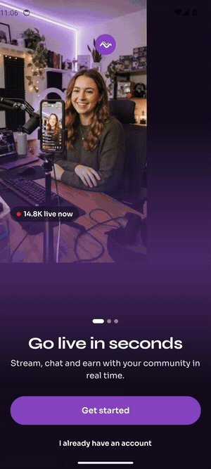

Captured on an Android emulator. The same codebase builds for iOS.

## Screens

| Welcome | Home (first run) | Home | Explore |
|---|---|---|---|
| 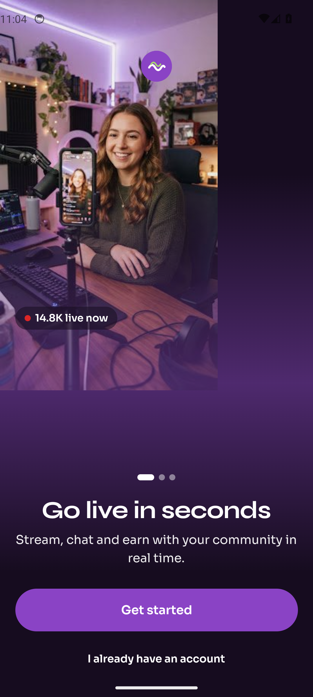 | 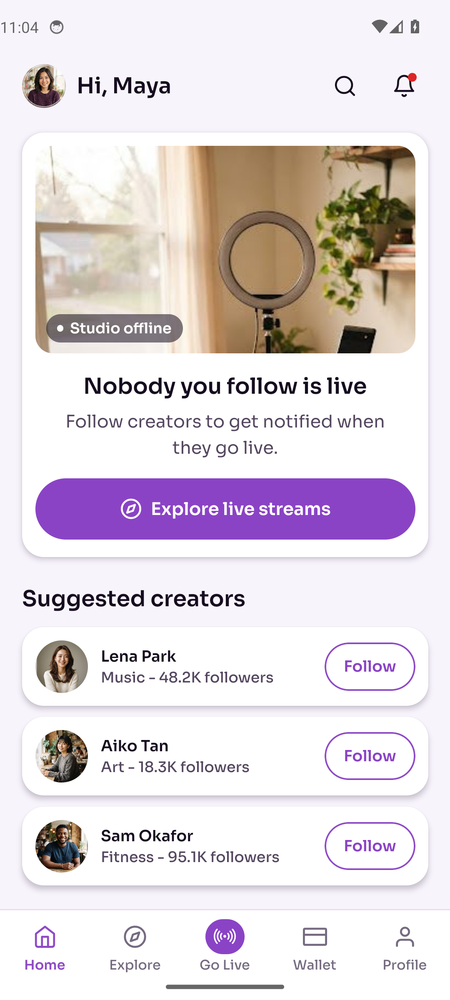 | 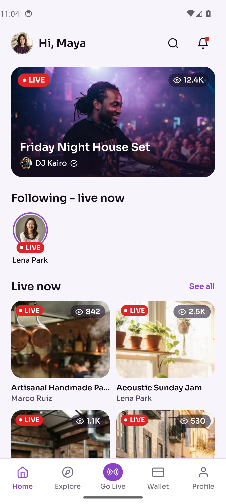 | 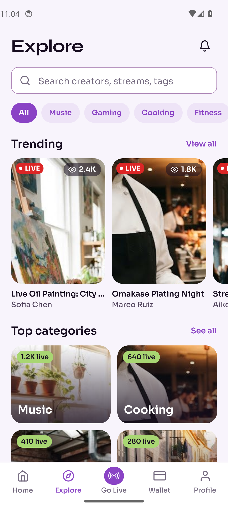 |

| Creator profile | Watch live | Gift sheet | Go live setup |
|---|---|---|---|
| 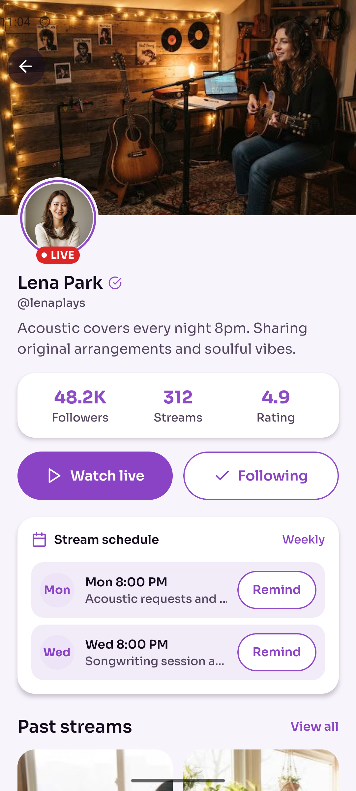 | 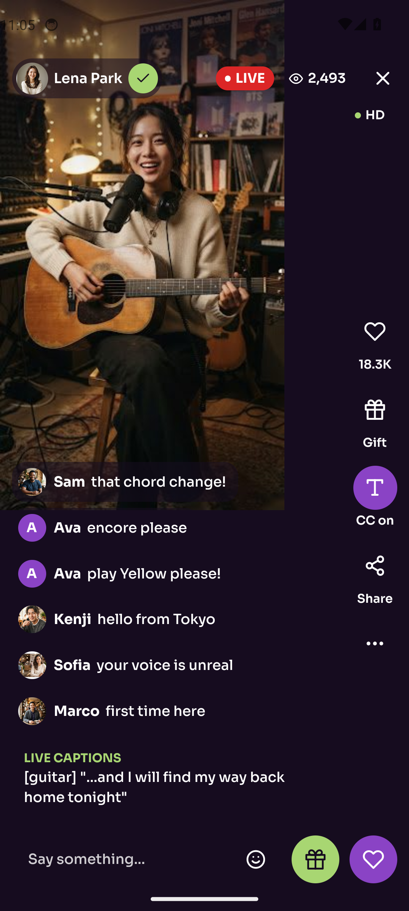 | 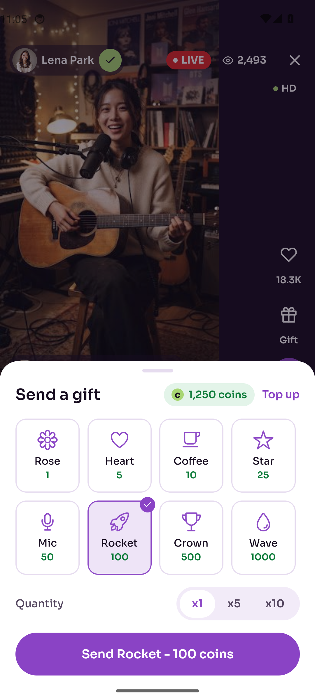 | 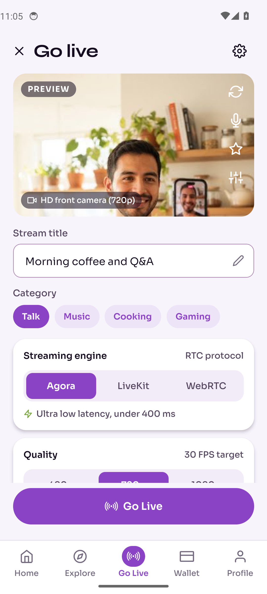 |

| Host live room | Stream health | Live summary | Wallet |
|---|---|---|---|
| 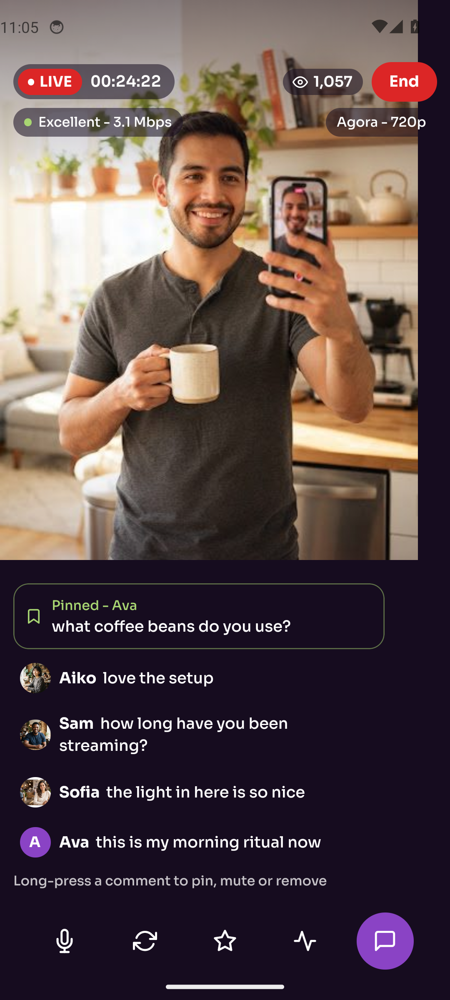 | 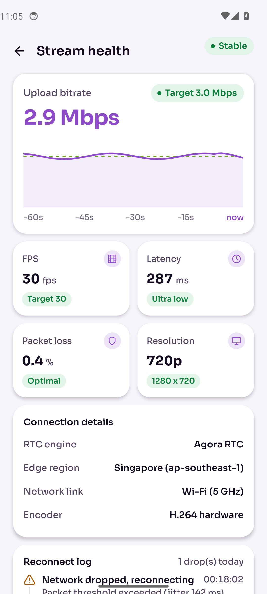 | 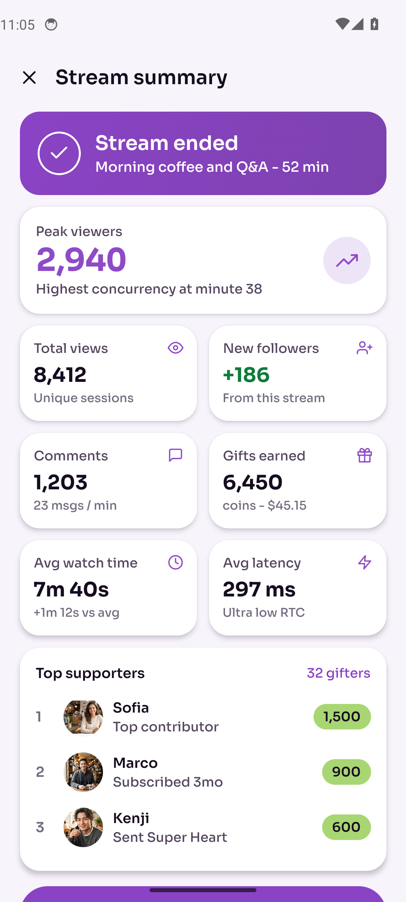 | 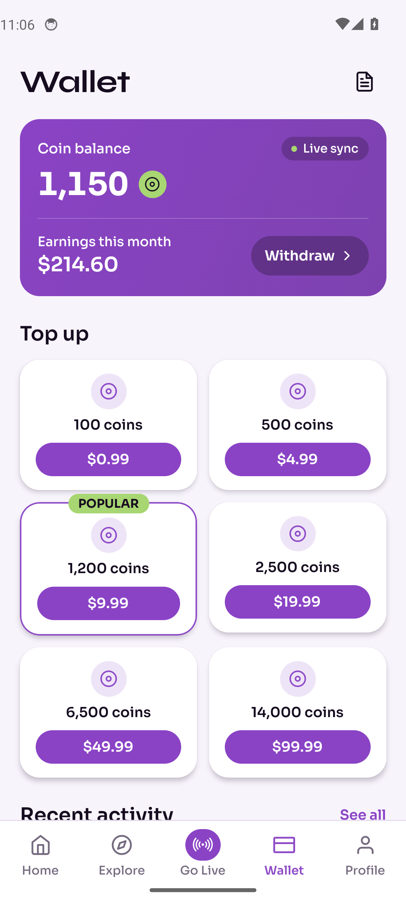 |

| Profile | Stream settings |
|---|---|
| 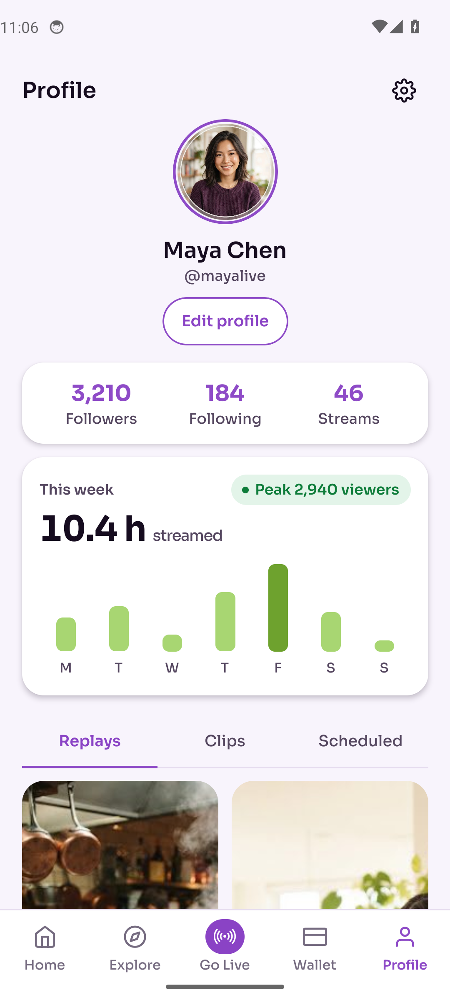 | 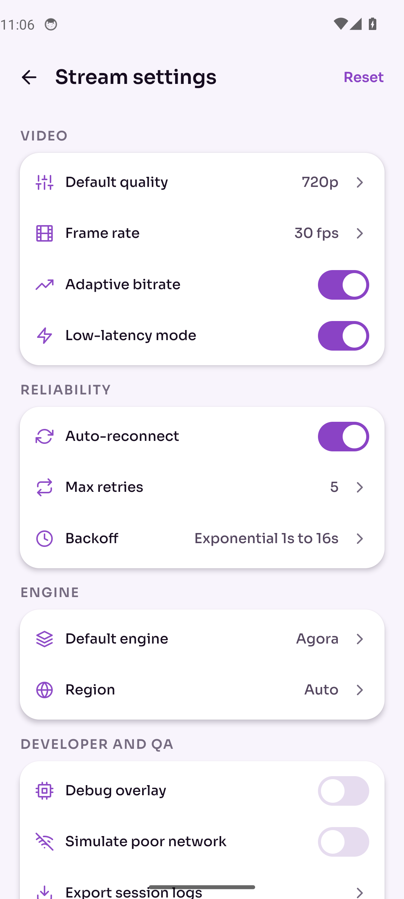 |

## What it shows

- **Live feed discovery**: featured stream, "Following - live now" row, live-now grid; explore with search, category chips, trending carousel, top categories and rising creators.
- **First-run state**: a new account follows nobody, so Home shows "Nobody you follow is live" with suggested creators; following one fills the feed.
- **Viewer watch screen**: full-screen video, creator chip with Follow, LIVE and viewer pills, action rail, live comments arriving in real time, floating hearts, live captions (CC) and a report / block menu.
- **Reactions and gifts**: a 4x2 gift sheet (Rose to Wave) with quantity, priced in coins; sending deducts the balance, posts a gift row in chat and logs it in the wallet.
- **Host go-live**: camera preview, title, category, streaming engine choice (Agora / LiveKit / WebRTC), quality preset, adaptive bitrate and a pre-flight check.
- **Host live room**: broadcast timer, live viewer count, incoming comments, gift alert banner, long-press moderation (pin, mute, remove), mic and chat toggles, end stream.
- **Stream health diagnostics**: live bitrate chart against the quality target, FPS, latency, packet loss, resolution, connection details, a reconnect log with exponential backoff (simulate a network drop to watch it retry and recover) and a debug overlay toggle.
- **Post-stream summary**: duration, peak viewers, views, new followers, comments, gifts earned (with payout value), average latency and top supporters.
- **Coin wallet, profile and settings**: balance, top-up packs, earnings and activity; profile with weekly streamed hours and replays; stream settings for quality, frame rate, low-latency, auto-reconnect retries and backoff, default engine and QA toggles.

Video, camera, RTC engines and payments are simulated with mock data so every screen runs on an emulator with no hardware or backend.

## App flow

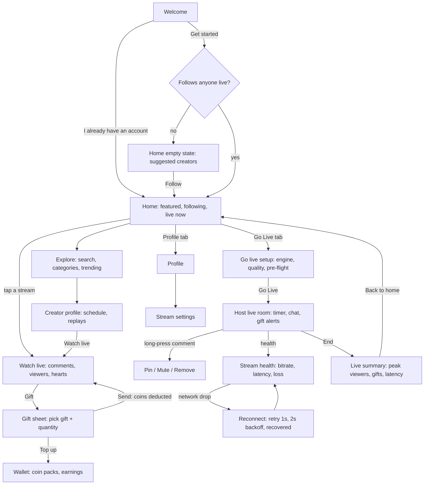

## Architecture

```
src/
  app/                    expo-router screens
    index.tsx             welcome
    (tabs)/               home, explore, golive, wallet, profile + shared tab bar
    creator/[id].tsx      creator profile
    watch/[id].tsx        viewer room (+ gift sheet)
    host/                 live room, stream health, summary
    settings.tsx          stream settings
  store/index.ts          Zustand store: follows, coins, activity, settings, live session
  logic/                  pure rules with node:test unit tests
    format.ts             compact counts, clock, money
    health.ts             health classification, exponential backoff, adaptive bitrate
    wallet.ts             gift totals, balance checks, coin payout
  data/                   models, mock creators/streams/gifts, bundled photography
  components/             LIVE + viewer pills, stream card, comment bubble, floating hearts,
                          gift sheet, line chart, buttons, chips, toggles, tab bar
  theme/tokens.ts         colors, type scale (Sora + Syne), radius, spacing
design/                   source design: per-screen HTML + PNG, DESIGN.md, brief.json
```

- **State**: one Zustand store. `startLive` creates the session and a single 1 s broadcast clock that advances timer, viewers, chat, gifts and bitrate samples for both the host room and the health screen; `endLive` stops it and keeps the totals for the summary.
- **Engine layer**: the engine choice (Agora, LiveKit, WebRTC) is carried through the session and shown in health and connection details. A production build swaps the simulated clock for the SDK's stats callbacks (for example Agora `onRtcStats` or LiveKit `ConnectionQuality` events) feeding the same store fields.
- **Reconnect**: `simulateDrop` logs the drop, retries on the backoff schedule from settings (1s, 2s, ... capped at 16s) and records the recovery time.

## Run

```bash
npm install
npx expo start          # press a for Android, i for iOS
npm test                # unit tests for the format, health and wallet rules
npm run typecheck
```

Requires Node 22. No backend or API keys needed.
